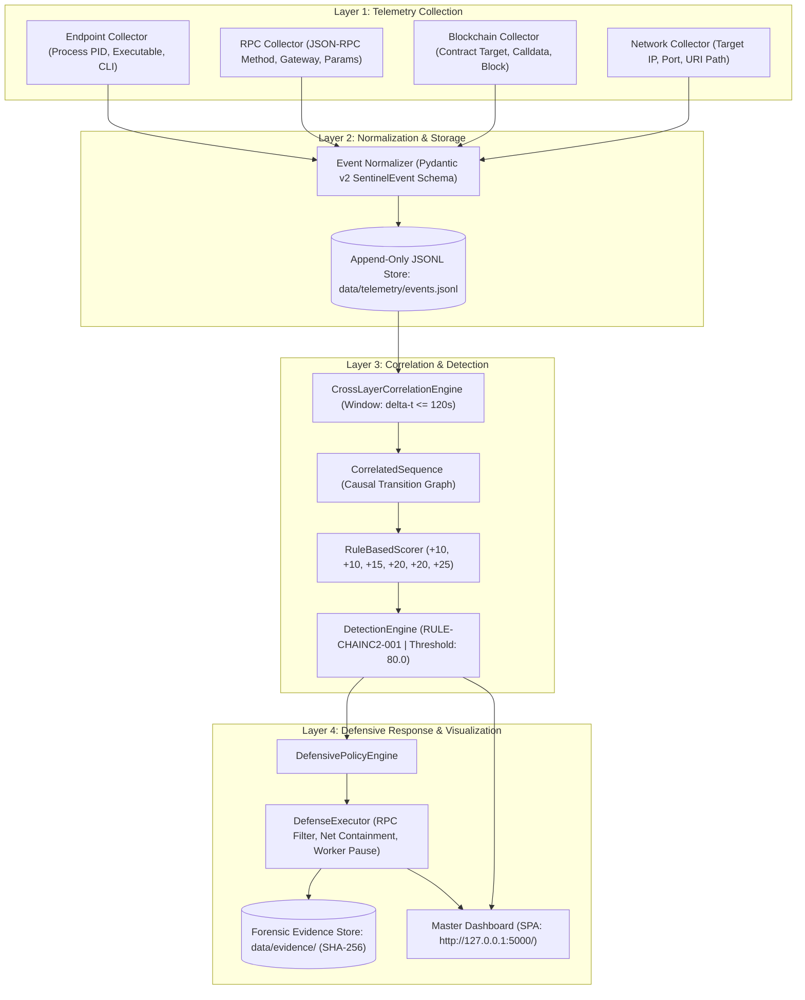

# ChainC2 Sentinel

### A Cybersecurity Framework for Detecting Blockchain-Mediated Command-and-Control Channels

**Engineering Capstone Project – I**
**B.Tech Computer Science and Engineering — Cybersecurity Specialization**
**Academic Year: 2026–2027**
**Institution:** Koneru Lakshmaiah Education Foundation (KLH), Hyderabad, India

---

## 1. Project Title & Subtitle

- **Project Title:** ChainC2 Sentinel
- **Subtitle:** A Cybersecurity Framework for Detecting Blockchain-Mediated Command-and-Control Channels

---

## 2. Team & Academic Supervision

### Student Team Members

| S. No. | Student Name | University ID Number | Email / GitHub Contact |
|:---:|:---|:---:|:---|
| 1 | Surakanti Rithik Reddy | 2320030094 | [GitHub Profile](https://github.com/KarthikeyaSukka756) |
| 2 | Karthikeya Sukka | 2320030097 | [GitHub Profile](https://github.com/KarthikeyaSukka756) |
| 3 | Abhinav Kavarthapu | 2320030307 | [GitHub Profile](https://github.com/KarthikeyaSukka756) |

### Academic Supervision

- **Project Supervisor:** Dr. V. Muniraj Naidu
- **Designation:** Associate Professor
- **Department:** Department of Computer Science and Engineering
- **Institution:** Koneru Lakshmaiah Education Foundation (KLH), Bowrampet, Hyderabad, India

---

## 3. Abstract

Decentralized smart-contract platforms have introduced new operational surfaces for cyber adversaries, including the exploitation of public blockchains as Command-and-Control (C2) infrastructure. Unlike conventional Web2 C2 systems that rely on centralized servers, dynamic DNS names, or IP addresses subject to domain sinkholing and IP blacklisting, blockchain-mediated C2 leverages immutable smart contracts and decentralized transactions as persistent dead-drop resolvers. Endpoint hosts query these instructions using standard JSON-RPC interfaces over HTTPS (`eth_call`, `eth_getLogs`) through legitimate public or enterprise gateways, rendering perimeter firewall inspection ineffective based on destination port (TCP 443) or IP reputation alone.

**ChainC2 Sentinel** is a defensive cybersecurity framework designed to detect, analyze, and mitigate blockchain-mediated C2 channels through deterministic cross-layer telemetry correlation. The framework unifies four heterogeneous telemetry layers—host endpoint execution (PID, command-line arguments, process lineage), JSON-RPC gateway queries, smart-contract interaction parameters, and subsequent outbound network connections—into a standardized Pydantic v2 schema (`SentinelEvent`). A temporal correlation engine reconstructs causal event transition sequences within bounded time windows ($\Delta t \le 120\text{s}$), evaluating an explainable, rule-based weighted scoring model (`RULE-CHAINC2-001`, threshold 80.0/100.0) that produces transparent forensic evidence without opaque machine learning hallucinations.

The framework was evaluated in a controlled laboratory testbed utilizing a local Hardhat Ethereum Virtual Machine (EVM, Chain ID 31337) and synthetic Solidity contracts (`C2DataStore`, `BenignDAppContract`, `LegitimateDAppContract`). Across an empirical 30-run benchmark and an authoritative 81-run research campaign, the detection pipeline achieved a 100.0% Detection Rate (Recall) and a 0.0% False-Positive Rate ($FP=0$), with an average rule processing latency of 0.102 ms across basic benign Web3 interactions and realistic multi-step enterprise DApp lifecycles. Once detected, an automated policy engine executes application-layer defensive mitigations (RPC contract filtering, local beacon blocking, cooperative scenario worker isolation, and SHA-256 forensic snapshotting) in an average latency of 2.091 ms while preserving 100.0% of legitimate Web3 traffic. These results quantify the detectability and containment of blockchain-mediated communication in a controlled environment; they do not assert universal efficacy against real-world in-the-wild advanced persistent threats.

---

## 4. Problem Statement

Conventional network defense relies heavily on centralized infrastructure seizure: security teams sinkhole malicious domains, coordinate IP routing withdrawals with internet service providers, or block egress traffic to identified C2 servers.

When adversaries employ smart contracts as dead-drop resolvers:
1. **Decentralized Immutability:** Transactions and contract bytecode deployed to a decentralized blockchain cannot be modified, deleted, or revoked by network administrators.
2. **Encrypted RPC Concealment:** Endpoint hosts communicate with the blockchain via standard JSON-RPC protocols over TLS targeting major public nodes (Infura, Alchemy, PublicNode). Because the destination IP and port (443) belong to trusted infrastructure, perimeter firewalls cannot differentiate between malicious C2 queries and legitimate Web3 DeFi usage.
3. **Observation Silos:** Endpoint Detection and Response (EDR) systems observe process execution but lack smart-contract context. Conversely, blockchain ledger analytics platforms observe transaction calldata but lack host process attribution. There is a fundamental visibility gap linking host process execution to on-chain dead-drop retrieval and subsequent network beaconing.

---

## 5. Research Gap

Prior academic and industry research exhibits three distinct shortcomings:

1. **Disconnected Telemetry Silos:** Previous studies analyze on-chain ledger anomalies or endpoint behavior in isolation. No existing open-source framework correlates endpoint process metadata, JSON-RPC queries, smart-contract function selectors, and subsequent socket activity into a unified causal graph.
2. **High False-Positive Rates on Legitimate Web3 Workloads:** Simple heuristic detectors that flag endpoints querying blockchain nodes trigger intolerable false alarms in developer, enterprise, or DeFi environments. Prior works lack evaluation against complex, multi-step DApp task lifecycles (Scenario C).
3. **Lack of Controlled Application-Layer Containment:** Because decentralized smart contracts cannot be taken down, defenders require fine-grained application-layer response mechanisms that filter malicious contract calls at local RPC proxies while maintaining business DApp availability.

---

## 6. Project Objectives

1. **Multi-Source Telemetry Architecture:** Implement four modular collectors (Endpoint, RPC, Blockchain, Network) standardizing heterogeneous events into a strict Pydantic v2 model (`SentinelEvent`).
2. **Deterministic Cross-Layer Correlation:** Construct a correlation engine (`CrossLayerCorrelationEngine`) reconstructing causal transition graphs within sliding time windows ($\Delta t \le 120\text{s}$).
3. **Explainable Weighted Rule Scoring:** Formulate an explainable scoring model (`RuleBasedScorer`) allocating weighted points (+10, +10, +15, +20, +20, +25) with a defined 80.0-point threshold.
4. **Controlled Laboratory EVM Testbed:** Develop a local Hardhat testbed (Chain ID 31337) and synthetic Solidity smart contracts (`C2DataStore`, `BenignDAppContract`, `LegitimateDAppContract`) to safely test scenarios with zero real malware and zero gas expenditure.
5. **Empirical Evaluation Campaigns:** Conduct rigorous empirical testing (30-run balanced benchmark and 81-run matrix campaign) measuring Recall, Precision, Specificity, Accuracy, and Latency.
6. **Coordinated Defensive Mitigation:** Develop an automated response executor enforcing RPC proxy filtering, network containment, cooperative worker isolation, and SHA-256 forensic snapshotting.
7. **Production Monitoring & Web Dashboard:** Deploy a read-only Ethereum Sepolia testnet monitor (Chain ID 11155111) and single-page application (SPA) dashboard on Zoho Catalyst CloudScale.

---

## 7. System Overview

ChainC2 Sentinel operates across two primary pipelines:

```
┌────────────────────────────────────────────────────────────────────────┐
│                        PHASE 1 — DETECTION PIPELINE                    │
│   Endpoint Context ──> RPC Gateway ──> Smart Contract ──> Network Out │
│                           │                                            │
│                           ▼                                            │
│   Normalization ──> Cross-Layer Correlation ──> Explainable Scoring    │
└───────────────────────────────────┬────────────────────────────────────┘
                                    │ Detection Alert (Score ≥ 80.0)
                                    ▼
┌────────────────────────────────────────────────────────────────────────┐
│                        PHASE 2 — PROTECTION PIPELINE                   │
│   Policy Engine ──> Layered Mitigations ──> Forensic Snapshots (SHA256)│
│                     - RPC Filter (Reject C2DataStore)                  │
│                     - Network Containment (Reject /beacon)             │
│                     - Worker Isolation (Cooperative Pause)             │
│                     - State Rollback Verification                      │
└────────────────────────────────────────────────────────────────────────┘
```

The system operates strictly within an isolated laboratory for synthetic experiments, while providing an ambient, read-only transaction observer for the public Ethereum Sepolia testnet.

---

## 8. Architecture & Data Flow

### Multi-Layer Data Flow Diagram



---

## 9. Technology Stack

- **Backend & Core Engine:** Python 3.10+ (tested on Python 3.11 and 3.14)
- **Data Validation & Schemas:** Pydantic v2 (strict model validation, ISO-8601 UTC timestamps)
- **REST API & Web Server:** Flask 3.0+ / WSGI
- **RPC Telemetry Proxy:** Python `aiohttp` / non-blocking asynchronous proxy
- **Blockchain Infrastructure:** Node.js 18+, Hardhat EVM (Local, Chain ID 31337)
- **Smart Contracts:** Solidity 0.8.20 (`C2DataStore`, `BenignDAppContract`, `LegitimateDAppContract`)
- **Ethereum Client Library:** ethers.js v6 / web3.py / custom lightweight `LocalRpcClient`
- **Frontend Dashboard:** Pure Vanilla ES6 JavaScript, HTML5, CSS3 (zero external CDN or runtime dependencies)
- **Testing Frameworks:** `pytest` 9.0+, `pytest-asyncio`, Mocha/Chai (Hardhat)
- **Cloud Deployment:** Zoho Catalyst Serverless (Web Client) & AppSail (Python 3.11 container)

---

## 10. Repository Structure

```
KLH-CSE-Y23-2320030097-ChainC2-Sentinel/
├── README.md                            # Comprehensive Root Documentation
├── catalyst.json                        # Zoho Catalyst Project Configuration
├── requirements.txt                     # Declared Python Dependencies
├── pytest.ini                          # Pytest Configuration and Test Markers
├── appsail/                             # Zoho Catalyst AppSail Deployment Package
│   ├── app-config.json                  # AppSail Container Configuration
│   └── .catalystignore                  # Packaging Exclusion Rules
├── client/                              # Zoho Catalyst Web Client Distribution
│   ├── index.html                       # Static Web Dashboard Entrypoint
│   └── static/                          # CSS and Modular JavaScript
├── docs/                                # Technical Specifications & Academic Deliverables
│   ├── academic/                        # University Deliverables (PRC-I, PRC-II, PRC-III)
│   ├── DEFENSIVE_RESPONSE_SPEC.md       # Layered Mitigation Specification
│   ├── DEVELOPMENT_PLAN.md              # Research Milestones & Threat Model
│   ├── LOCAL_RESEARCH_BASELINE.md       # Corrected 81-Run Research Specification
│   ├── PROJECT_COMPLETION_STATUS.md     # Defect Matrix & Verification Audit
│   └── TELEMETRY_ARCHITECTURE.md        # Event Schema & Normalization Design
├── functions/                           # Catalyst Serverless Functions
│   └── sepolia_cron/                    # Ephemeral Blockchain Ingestion Observer
├── public/                              # Mirrored Static Asset Distribution
├── reports/                             # Research Analysis & Academic Reports
│   └── final/                           # FINAL_RESEARCH_ANALYSIS.md, DETECTION_ANALYSIS.md
├── results/                             # Processed Benchmark Results (JSON, CSV)
│   ├── detection/                       # Detection Summary & Experiment History CSV
│   ├── protection/                      # Mitigation Metrics & Experiment Results CSV
│   └── final/                           # Consolidated research_summary.json
├── data/                                # Telemetry, Datasets, and Forensic Snapshots
│   ├── evaluation/                      # Evaluation JSON Datasets (30-run & 81-run campaign)
│   ├── evidence/                        # Preserved Forensic Evidence Bundles (SHA-256)
│   └── telemetry/                       # Runtime Telemetry & Cursor State Files
├── src/                                 # Framework Implementation Source Code
│   ├── blockchain/                      # Smart Contracts, Local EVM, Sepolia Monitor
│   ├── collectors/                      # Telemetry Collectors (Endpoint, RPC, BC, Net)
│   ├── correlation/                     # Cross-Layer Temporal Correlation Engine
│   ├── dashboard/                       # Flask Web Application & REST API
│   ├── detection/                       # Rule Scorer, Rule Definitions, Detection Engine
│   ├── http_target/                     # Controlled Local HTTP Target Server
│   ├── models/                          # Pydantic v2 SentinelEvent Data Models
│   ├── normalizer/                      # Event Normalization & JSONL Persistence
│   ├── protection/                      # Defense Executor, Handlers, Policy Engine
│   ├── rpc_proxy/                       # Non-blocking JSON-RPC Inspection Proxy
│   ├── scenarios/                       # Controlled Scenarios (A, B, C) & Runner
│   └── utils/                           # UUID Generation & Structured Logging
└── tests/                               # Comprehensive Automated Test Suites (427+ tests)
```

---

## 11. Prerequisites

Before installing, ensure the host machine has the following runtimes installed:

- **Python:** Version 3.10, 3.11, or 3.12+ (tested up to 3.14)
- **Node.js:** Version 18.0.0 or higher
- **npm:** Version 9.0.0 or higher
- **Git:** Version 2.30+

---

## 12. Complete Setup Instructions

### Step 1: Clone the Repository
```bash
git clone https://github.com/KarthikeyaSukka756/KLH-CSE-Y23-2320030097-ChainC2-Sentinel.git
cd KLH-CSE-Y23-2320030097-ChainC2-Sentinel
```

### Step 2: Create and Activate Virtual Environment
```bash
# On Linux / macOS:
python3 -m venv venv
source venv/bin/activate

# On Windows (PowerShell):
python -m venv venv
.\venv\Scripts\Activate.ps1

# On Windows (Command Prompt):
.\venv\Scripts\activate.bat
```

### Step 3: Install Python Dependencies
```bash
pip install --upgrade pip
pip install -r requirements.txt
```

### Step 4: Install Hardhat & Smart Contract Dependencies
```bash
cd src/blockchain
npm install
cd ../..
```

---

## 13. Environment Configuration Instructions

Copy the template environment file to create your local `.env`:
```bash
cp .env.example .env
```

### Configuration Variables Reference

| Variable Name | Default Value | Description |
|:---|:---|:---|
| `CHAINC2_ENV` | `development` | Runtime environment (`development`, `testing`, `production`). |
| `CHAINC2_HOST` | `127.0.0.1` | Local host interface binding (strictly loopback for safety). |
| `CHAINC2_PORT` | `5000` | Port for the Master Dashboard Flask server. |
| `HARDHAT_RPC_URL` | `http://127.0.0.1:8545` | Local Hardhat EVM RPC endpoint. |
| `SEPOLIA_RPC_URL` | `https://ethereum-sepolia-rpc.publicnode.com` | Public read-only Sepolia RPC gateway ($0.00 cost). |
| `CHAINC2_AUTO_START_MONITOR` | `1` | Automatically launch continuous Sepolia ingestion daemon (`1` or `0`). |
| `CHAINC2_POLL_INTERVAL` | `15.0` | Sepolia polling loop interval in seconds. |
| `CHAINC2_CORRELATION_WINDOW` | `120.0` | Maximum sliding time window ($\Delta t$) for correlation in seconds. |
| `CHAINC2_DETECTION_THRESHOLD` | `80.0` | Rule scoring threshold for alert triggering (out of 100.0). |

*Note: Never commit real private keys or API tokens. All Sepolia testnet monitoring is public and read-only.*

---

## 14. Exact Application Execution Commands

### Running the Master Dashboard Server
From the repository root:
```bash
python -m src.dashboard.run
```
Or alternatively via the standard WSGI entrypoint:
```bash
python src/index.py
```

### Accessing the Dashboard Interface
Open your web browser and navigate to:
```
http://127.0.0.1:5000/
```

### Starting the Standalone Sepolia Ingestion Daemon
```bash
python scripts/run_monitor.py --interval 15.0
```

### Starting the Standalone Controlled Scenario Generator
```bash
python scripts/run_generator.py --mode step --max-cycles 4
```

---

## 15. Dashboard Startup & Access Instructions

The Master Dashboard is structured into 7 dedicated operational views:

1. **#live-monitor:** Displays live Sepolia chain head block, ingestion cursor, monitoring lag, and recent public transactions with real-time daemon controls (`Start / Stop Ingestion`).
2. **#alerts:** Displays durable, explainable detection alerts with confidence scores, condition badges, and timestamps.
3. **#investigations:** Deep multi-layer causal inspection view showing chronological transitions across Endpoint, RPC, Blockchain, and Network layers.
4. **#detection-scoring:** Live scoring breakdown visualizing weights (+10, +10, +15, +20, +20, +25) against the 80.0-point threshold.
5. **#mitigation-verification:** Displays executed defensive actions (RPC filtering, network containment, process isolation) with verified/partially verified status.
6. **#audit-trail:** Cryptographic forensic log showing preserved evidence bundle checksums (SHA-256).
7. **#system-health:** Service component health diagnostics, RPC latency, and credit balances.

---

## 16. Local Laboratory & Scenario Execution Instructions

The local laboratory executes controlled synthetic scenarios against an isolated Hardhat EVM testbed:

### Step 1: Start the Local Hardhat EVM Node
In a separate terminal:
```bash
cd src/blockchain
npx hardhat node
```
*Node initializes at `http://127.0.0.1:8545` with Chain ID `31337`.*

### Step 2: Deploy Synthetic Smart Contracts
In another terminal:
```bash
cd src/blockchain
npx hardhat run scripts/deploy.js --network localhost
cd ../..
```
*Contracts deployed: `C2DataStore`, `BenignDAppContract`, `LegitimateDAppContract`.*

### Step 3: Run the Controlled Laboratory Scenarios
Execute on-demand scenarios using the Python CLI:
```bash
# Execute Scenario A (Benign Web3 Negative Control):
python -c "from src.scenarios.runner import ScenarioRunner; r = ScenarioRunner(); print(r.run_scenario('scenario_a'))"

# Execute Scenario B (Synthetic C2 Positive Control):
python -c "from src.scenarios.runner import ScenarioRunner; r = ScenarioRunner(); print(r.run_scenario('scenario_b'))"

# Execute Scenario C (Legitimate Multi-Step DApp Baseline):
python -c "from src.scenarios.runner import ScenarioRunner; r = ScenarioRunner(); print(r.run_scenario('scenario_c'))"

# Execute Run All 3 (Strictly isolated executions):
python -c "from src.scenarios.runner import ScenarioRunner; r = ScenarioRunner(); print(r.run_all())"
```

---

## 17. Test Execution Commands

The repository includes a comprehensive, verified automated test suite of over 427 tests:

```bash
# 1. Run full non-integration test suite (all unit, correlation, scoring, and detection tests):
pytest -m "not integration and not slow" -v

# 2. Run Sepolia monitoring tests (contiguous cursor, atomic sync, lifecycle recovery):
pytest tests/test_sepolia_monitor.py -v

# 3. Run blocking defects regression suite (Defects A, B, C verification):
pytest tests/test_blocking_defects_repair.py -v

# 4. Run dashboard static asset parity tests:
pytest tests/test_dashboard_acceptance.py -k "static_asset" -v

# 5. Run Hardhat Solidity contract tests (35 passing):
cd src/blockchain
npx hardhat test
cd ../..

# 6. Verify Git formatting and whitespace integrity:
git diff --check
```

---

## 18. Evaluation and Reproducibility Instructions

### Reproducing Detection & Mitigation Metrics
Execute the automated evaluation harness to reproduce benchmark results:
```bash
# Run Detection Evaluator (generates results/detection/ artifacts):
python -c "from src.evaluation.evaluator import DetectionEvaluator; ev = DetectionEvaluator(); ev.run_evaluation(runs_per_scenario=10); ev.save_results()"

# Run Protection Evaluator (generates results/protection/ artifacts):
python -c "from src.protection.evaluation.evaluator import ProtectionEvaluator; pe = ProtectionEvaluator(); pe.run_evaluation(runs_per_scenario=10); pe.save_results()"
```

### Verifying Canonical 81-Run Research Evidence Hashes
Execute the historical artifact preservation test to verify that the locked research dataset has not been modified:
```bash
pytest tests/test_real_rpc_execution.py -k "HistoricalArtifactPreservation" -v
```

Expected SHA-256 Checksums:
- `data/evaluation/dataset_campaign/matrix_v2_81_results.json`: `15fa3d7e49a1cf5f8c1476a2ff5141849a46fb31eb021a3e2159a2d8998fd470`
- `data/evaluation/dataset_campaign/telemetry_events_balanced.jsonl`: `519c1e988e221d889ed499badb8bb704a69dd2c17c96dc42881ddafbbce35aa0`
- `data/evaluation/dataset_campaign/campaign_plan_372.json`: `0c483d093ee32c4122ae4c47fdc6fd62451b78991ec45bd25077f517f0c23bc7`
- `results/final/research_summary.json`: `85b1d136d61c7657c518eb2872eedf50f245e968d9997178ca04cdcce7930bcc`

---

## 19. Current Phase Status

The project strictly follows the seven-phase research plan:

| Phase | Description | Status | Verification Evidence |
|:---:|:---|:---:|:---|
| **Phase 1** | Literature survey, threat model, and system architecture design. | ✅ **COMPLETED** | Formal threat taxonomy, `docs/TELEMETRY_ARCHITECTURE.md`, PRC-I document. |
| **Phase 2** | Technical specifications, telemetry schema, and response design. | ✅ **COMPLETED** | `SentinelEvent` schema (Pydantic v2), `docs/DEFENSIVE_RESPONSE_SPEC.md`. |
| **Phase 3** | Controlled laboratory setup and local EVM environment. | ✅ **COMPLETED** | Hardhat EVM (31337), Solidity contracts (`C2DataStore`, `BenignDAppContract`, `LegitimateDAppContract`), 35 passing tests. |
| **Phase 4** | Ingestion pipeline, proxy forwarding, and event normalization. | ✅ **COMPLETED** | 4 Collectors, `RpcTelemetryProxy`, normalizer, JSONL persistence. |
| **Phase 5** | Cross-layer correlation engine and explainable weighted scoring. | ✅ **COMPLETED** | `CrossLayerCorrelationEngine`, `RuleBasedScorer`, `RULE-CHAINC2-001`. |
| **Phase 6** | Testing, experimental evaluation, and defensive mitigations. | ✅ **COMPLETED** | 30-run baseline, 81-run matrix campaign, 22-run mitigation evaluation, 427 passing tests. |
| **Phase 7** | Research analysis, metric synthesis, dashboard & final documentation. | 🟢 **ACTIVE / FINALIZING** | Final analysis reports (`reports/final/`), Master Dashboard, PRC-I/II/III deliverables. |

**Overall Project Status:** 🟢 **Implementation Complete — Final Academic Presentation & Defense Stage**

---

## 20. Completed Features

- **Multi-Source Telemetry Collectors:** Endpoint (host process metadata), RPC (JSON-RPC method/parameters), Blockchain (contract target, decoded calldata), and Network (HTTP target IP/port).
- **Strict Event Normalization:** Standardized Pydantic v2 `SentinelEvent` data model with ISO-8601 UTC timestamps.
- **Cross-Layer Correlation Engine:** Multi-layer causal sequence graph reconstruction with configurable temporal sliding windows ($\Delta t \le 120\text{s}$).
- **Explainable Weighted Rule Scorer:** Factual heuristic scoring allocating +10, +10, +15, +20, +20, +25 points across 6 observable criteria (threshold $\ge 80.0$).
- **Controlled Laboratory EVM Testbed:** Isolated Hardhat EVM with 3 smart contracts simulating benign Web3, synthetic C2 dead-drops, and enterprise task workflows.
- **Coordinated Defensive Mitigation:** RPC proxy contract filtering, local network containment (HTTP 403 on `/beacon`), cooperative worker isolation, and SHA-256 evidence snapshotting.
- **Public Sepolia Testnet Monitor:** Contiguous sequential block ingestion, atomic cursor persistence (`.tmp` + `os.replace`), non-blocking debounced health checks, and race condition guards.
- **Decoupled Autonomous Architecture:** Standalone scenario generator (`src/scenarios/generator.py`) and remote telemetry ingestion API (`POST /api/telemetry/ingest`).
- **Master Web Dashboard:** 7-section single-page application with real-time transaction streaming, causal transition charts, confusion matrices, and evidence verification.
- **CloudScale Deployment:** Deployed and verified on Zoho Catalyst Serverless and AppSail.

---

## 21. In-Progress Work

- Finalizing academic presentation slides for the PRC-III university evaluation committee.
- Synthesizing comparative latency benchmarks across varying system load conditions.
- Preparing interactive demonstration walkthroughs of the local laboratory scenario workflow.

---

## 22. Outstanding Work & Known Limitations

- **Single-Host Laboratory Binding:** All synthetic C2 experiments execute on local loopback sockets (`127.0.0.1`). Real-world enterprise environments exhibit complex network jitter, NAT gateways, and multi-hop proxy chains.
- **Structured Payload Assumption:** The synthetic C2 scenario models dead-drops using structured JSON payloads. Advanced adversaries could utilize steganography, encrypted bytecode, or zero-knowledge rollups to conceal calldata.
- **User-Space Proxy Dependency:** The application-layer RPC filter relies on traffic traversing the local proxy. An adversary with root/administrator access could bypass the proxy by querying remote RPC endpoints directly.
- **Sepolia Public Testnet Boundaries:** Public Ethereum Sepolia monitoring is strictly read-only ($0.00 gas spend). In-the-wild malicious contracts are not deployed on public networks.

---

## 23. Security & Research-Scope Limitations

To maintain academic and operational integrity, the following boundaries are strictly enforced:
- **Zero Live Malware:** The project utilizes inert, harmless test payloads strictly restricted to the `BEACON` action targeting `127.0.0.1:8080/beacon`.
- **Zero Public Chain Mutation:** No synthetic attack transactions are submitted to Ethereum Mainnet or Sepolia.
- **Zero OS Kernel Tampering:** Defensive controls operate entirely in user-space (HTTP proxy filters and socket rejections); no kernel drivers or OS-wide firewall rules are manipulated.
- **Zero Gas Cost:** All testnet operations utilize public read-only nodes requiring $0.00 financial expenditure.

---

## 24. References

1. **Ali, R., et al.** (2020). *Smart Contracts as Attack Proxies.* In Proceedings of the IEEE Symposium on Security and Privacy (IEEE S&P). DOI: [10.1109/SP40000.2020.00012](https://doi.org/10.1109/SP40000.2020.00012).
2. **Purtell, K., & Buescher, M.** (2021). *Command and Control over Distributed Ledgers: Analysis and Mitigation Strategies.* Journal of Cybersecurity, 7(1), tyab014. DOI: [10.1093/cybsec/tyab014](https://doi.org/10.1093/cybsec/tyab014).
3. **Trend Micro Research.** (2019). *Botnets Using Blockchain Technology: An Emerging Threat.* Trend Micro Threat Defense Brief. URL: [https://www.trendmicro.com](https://www.trendmicro.com).
4. **Zimba, A., et al.** (2019). *Multi-stage Crypto-Ransomware Detection Using Cross-Layer Telemetry.* Computers & Security, 88, 101625. DOI: [10.1016/j.cose.2019.101625](https://doi.org/10.1016/j.cose.2019.101625).
5. **Antonakakis, M., et al.** (2017). *Understanding the Mirai Botnet.* In Proceedings of the 26th USENIX Security Symposium, pp. 1093–1110.
6. **Scarfone, K., & Mell, P.** (2007). *Guide to Intrusion Detection and Prevention Systems (IDPS).* National Institute of Standards and Technology (NIST) Special Publication 800-94. DOI: [10.6028/NIST.SP.800-94](https://doi.org/10.6028/NIST.SP.800-94).
7. **Buterin, V.** (2014). *Ethereum: A Next-Generation Smart Contract and Decentralized Application Platform.* Ethereum White Paper.
8. **Wood, G.** (2014). *Ethereum: A Secure Decentralised Generalised Transaction Ledger.* Ethereum Project Yellow Paper.

---
### End of README.md
