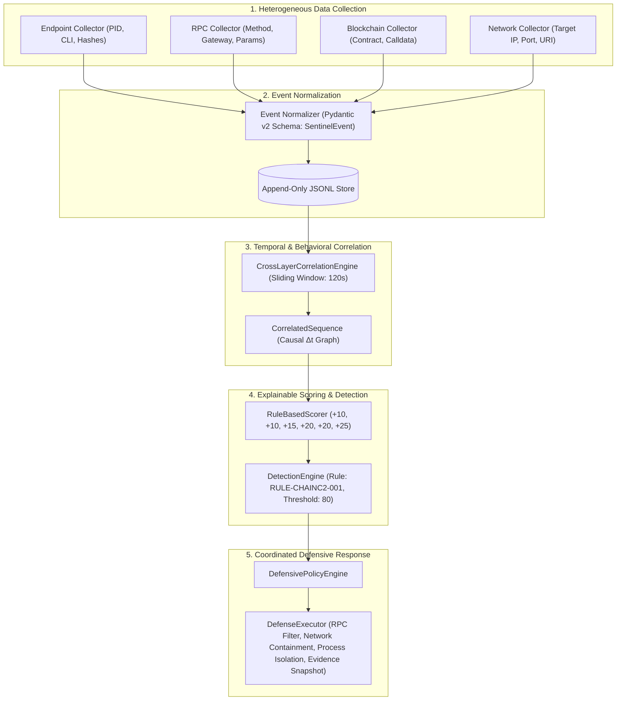

# PRC-II: Project Progress Presentation
## ChainC2 Sentinel: A Cybersecurity Framework for Detecting Blockchain-Mediated Command-and-Control Channels

**Department of Computer Science and Engineering**
**Koneru Lakshmaiah Education Foundation (KLH), Hyderabad, India**
**Engineering Capstone Project – I (2026–2027)**

---

### Slide 1: Title Slide
- **Project Title:** ChainC2 Sentinel: A Cybersecurity Framework for Detecting Blockchain-Mediated Command-and-Control Channels
- **Department:** Computer Science and Engineering (Cybersecurity Specialization)
- **Institution:** Koneru Lakshmaiah Education Foundation (KLH), Bowrampet, Hyderabad
- **Team Members:**
  - Surakanti Rithik Reddy (2320030094)
  - Karthikeya Sukka (2320030097)
  - Abhinav Kavarthapu (2320030307)
- **Project Supervisor:** Dr. V. Muniraj Naidu, Associate Professor, Department of CSE

---

### Slide 2: Project Overview & Context
- **Emerging Threat:** Malware command-and-control (C2) mediated by smart contracts and public blockchains.
- **Why Blockchains?** Immutable storage, distributed availability, censorship resistance, and standard JSON-RPC APIs provide an ideal dead-drop communication medium for resilient botnets.
- **Defensive Dilemma:** Network firewalls and EDR agents cannot distinguish malicious contract queries from routine Web3 decentralized application traffic based solely on destination port (443) or IP addresses.
- **Proposed Solution:** ChainC2 Sentinel correlates host endpoint activity, JSON-RPC queries, smart contract calldata, and subsequent local network beacons to provide explainable, high-accuracy detection and rapid application-layer containment.

---

### Slide 3: Two Core Research Questions
1. **Research Question 1 (RQ1 — Detection):**
   *"Can cross-layer telemetry correlation detect blockchain-mediated C2-like behavioral sequences while distinguishing them from legitimate Web3 activity?"*
   - *Target:* Reconstruct causal multi-layer event graphs ($\text{Endpoint} \to \text{RPC} \to \text{Blockchain} \to \text{Network}$) and evaluate explainable rule-based scoring.
2. **Research Question 2 (RQ2 — Protection):**
   *"Once the behavior is detected, what defensive measures can be applied?"*
   - *Target:* Apply coordinated application-layer defenses (RPC contract proxy filtering, local network containment, cooperative worker isolation, and SHA-256 evidence snapshotting) without disrupting benign Web3 traffic.

---

### Slide 4: System Architecture & Data Flow



---

### Slide 5: Experimental Methodology & Controlled Scenarios
Experiments are executed on an isolated local Hardhat EVM (Chain ID 31337) with synthetic smart contracts:
- **Scenario A (Benign Web3 Negative Control):**
  - Interacts with `BenignDAppContract.sol` (calling `getCount()` / `increment()`).
  - Generates endpoint, RPC, and blockchain events with **zero** subsequent network beaconing.
  - *Expected Score:* $35.0 / 100.0 \implies \text{NOT\_TRIGGERED}$ ($FP=0$).
- **Scenario B (Synthetic C2 Positive Control):**
  - Queries `C2DataStore.sol` for an inert payload (`{"scenario": "synthetic_c2", "command": "BEACON", "target": "http://127.0.0.1:8080/beacon"}`).
  - Emits subsequent local HTTP beacon.
  - Complete 4-layer causal chain: $\text{Endpoint} \to \text{RPC} \to \text{Blockchain} \to \text{Network}$.
  - *Expected Score:* $100.0 / 100.0 \implies \text{TRIGGERED}$ ($TP=1$).
- **Scenario C (Legitimate Multi-Step DApp Baseline):**
  - Executes realistic multi-step enterprise task lifecycle on `LegitimateDAppContract.sol` (create task $\to$ read task $\to$ update task $\to$ read status).
  - High-frequency Web3 activity with **zero** network follow-up.
  - *Expected Score:* $35.0 / 100.0 \implies \text{NOT\_TRIGGERED}$ ($FP=0$).

---

### Slide 6: Explainable Weighted Scoring Model (`src/detection/scoring.py`)

| Observable Factual Condition | Point Contribution | Rationale / Observable Evidence |
|:---|:---:|:---|
| **1. Endpoint Process Context** | **+10** | Monitored process PID, executable path, and process lineage verified. |
| **2. Blockchain RPC Interaction** | **+10** | Valid JSON-RPC method (`eth_call`, `eth_sendTransaction`) detected. |
| **3. Smart Contract Interaction** | **+15** | Target contract call verified against monitored registry addresses. |
| **4. Suspicious Data Retrieval** | **+20** | Non-trivial payload structure or encoded instruction string retrieved. |
| **5. C2 / Configuration Indicator** | **+20** | Retrieved payload matches synthetic instruction model (`BEACON`, target). |
| **6. Matched Subsequent Network Activity** | **+25** | Host initiates outbound HTTP connection matching retrieved contract parameters within $\Delta t \le 120\text{s}$. |
| **Total Possible Points** | **100** | **Detection Threshold:** $\mathbf{\ge 80.0 / 100.0}$ |

*Key Technical Advantage:* Deterministic scoring provides full transparency for security analysts; scoring contributions are directly mapped to specific timestamps and packet parameters.

---

### Slide 7: Phase 1 Detection Evaluation Results

Across an empirical 30-run benchmark (10 Scenario A, 10 Scenario B, 10 Scenario C):

```
                  PREDICTED POSITIVE     PREDICTED NEGATIVE
ACTUAL POSITIVE       TP = 10                  FN = 0
ACTUAL NEGATIVE       FP = 0                   TN = 20
```

- **Detection Rate (Recall):** $\mathbf{100.0\%}$ ($10/10$ positive C2 sequences detected).
- **False Positive Rate (FPR):** $\mathbf{0.0\%}$ ($0/20$ negative controls flagged across Scenarios A & C).
- **Precision:** $\mathbf{100.0\%}$ ($10/10$).
- **Specificity (TNR):** $\mathbf{100.0\%}$ ($20/20$).
- **Accuracy:** $\mathbf{100.0\%}$ ($30/30$).
- **Detection Processing Latency:** Average of **$0.102\text{ ms}$** (min: $0.045\text{ ms}$, max: $0.688\text{ ms}$).

---

### Slide 8: Phase 2 Defensive Mitigation Evaluation Results

Across 22 controlled laboratory experiments (10 Benign A, 10 Synthetic C2 B, 2 Fault Injections):

| Measured Defensive Dimension | Benchmark Result | Operational Impact |
|:---|:---:|:---|
| **Mitigation Success Rate** | **100.0%** ($40/40$ actions) | All defensive plan actions executed and verified. |
| **RPC Filtering Rate** | **100.0%** ($10/10$ blocked) | Subsequent queries targeting `C2DataStore` rejected with HTTP 403. |
| **Network Containment Rate** | **100.0%** ($10/10$ blocked) | HTTP `/beacon` requests rejected; `/health` preserved. |
| **Process Isolation Success Rate**| **100.0%** ($10/10$ isolated) | Registered synthetic scenario workers safely paused. |
| **Legitimate Traffic Preservation** | **100.0%** ($22/22$ preserved) | Benign dApp transactions and health endpoints unaffected. |
| **False Mitigation Rate** | **0.0%** ($0/10$ mitigated) | Benign Scenario A runs received zero defensive actions. |
| **Rollback Verification** | **100.0%** ($10/10$ restored) | Baseline state verified after defensive rollback. |
| **Forensic Evidence Snapshotting**| **100.0%** ($10/10$ snapshots) | Immutable JSON bundles created with SHA-256 checksums. |
| **Average Containment Latency** | **2.091 ms** | Minimum: $1.49\text{ ms}$, Maximum: $3.56\text{ ms}$. |

---

### Slide 9: Seven-Phase Project Schedule & Implementation Status

```
Phase 1: Literature Survey, Threat Model & System Architecture Design    ─── [COMPLETED]
Phase 2: Technical Specifications & Telemetry Schema Standardization     ─── [COMPLETED]
Phase 3: Controlled EVM Laboratory Setup & Smart Contract Development    ─── [COMPLETED]
Phase 4: Multi-Source Telemetry Ingestion & Proxy Forwarding              ─── [COMPLETED]
Phase 5: Cross-Layer Correlation Engine & Explainable Weighted Scoring   ─── [COMPLETED]
Phase 6: Empirical Benchmark Evaluation (30 & 81 Runs) & Defense Testing  ─── [COMPLETED]
Phase 7: Research Analysis, Master Dashboard & Academic Deliverables     ─── [ACTIVE - FINALIZING]
```

- **All Unit & Regression Tests:** **427/427 Passing** (4 deselected integration tests requiring live Hardhat EVM).
- **Hardhat Smart Contract Tests:** **35/35 Passing**.
- **Canonical Evaluation Campaign Artifacts:** 100% SHA-256 byte-for-byte verified.

---

### Slide 10: Conclusion & Next Steps for PRC-III
- **Conclusion:** Cross-layer telemetry correlation successfully resolves the blind spot of blockchain-mediated C2 channels, achieving 100% recall and 0% false positives in the testbed, while application-layer defense neutralizes threats in ~2.09 ms.
- **Immediate Steps for Final PRC-III Defense:**
  1. Complete comprehensive technical presentation slides using the university template.
  2. Finalize cross-document verification across the root `README.md`, technical reports, and thesis documentation.
  3. Prepare live demonstration of the Master Dashboard and local EVM scenario workflow.

---
### End of PRC-II Presentation Document
