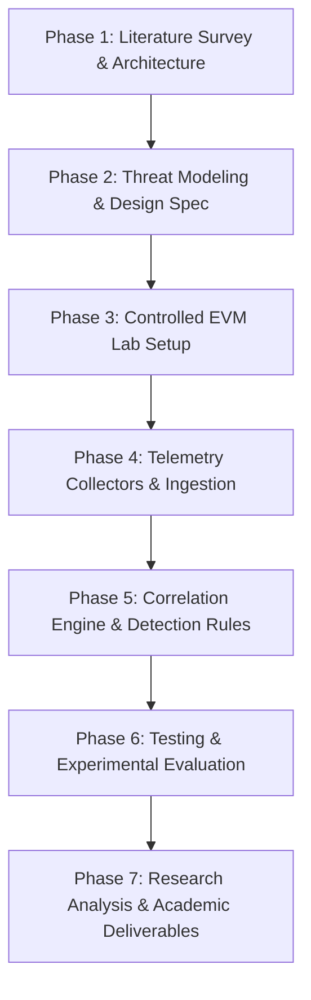

# PRC-I: Project Review & Conceptualization
## ChainC2 Sentinel: A Cybersecurity Framework for Detecting Blockchain-Mediated Command-and-Control Channels

**Department of Computer Science and Engineering**
**Koneru Lakshmaiah Education Foundation (KLH), Hyderabad, India**
**Programme:** B.Tech Computer Science and Engineering (Cybersecurity Specialization)
**Academic Year:** 2026–2027

---

### Team Information

| S. No. | Student Name | University ID | Role / Specialization |
|:---:|:---|:---:|:---|
| 1 | Surakanti Rithik Reddy | 2320030094 | Telemetry Collection & Event Normalization |
| 2 | Karthikeya Sukka | 2320030097 | Cross-Layer Correlation & Detection Engineering |
| 3 | Abhinav Kavarthapu | 2320030307 | Smart Contract Development & Evaluation Analysis |

**Project Supervisor:** Dr. V. Muniraj Naidu, Associate Professor, Department of CSE, KLH Hyderabad

---

## 1. Project Title, Problem Statement, and Objectives

### 1.1 Project Title
**ChainC2 Sentinel: A Cybersecurity Framework for Detecting Blockchain-Mediated Command-and-Control Channels**

### 1.2 Problem Statement
Decentralized blockchain networks provide immutable, permissionless, and distributed communication primitives. While designed for financial transactions and decentralized applications (DApps), these same properties make blockchains an emerging operational surface for malware Command-and-Control (C2) communication.

In conventional Web2 C2 infrastructures, malicious actors rely on centralized servers, domain names, or IP addresses. Defenders routinely counter these threats using Domain Name System (DNS) sinkholing, IP blacklisting, and Border Gateway Protocol (BGP) routing withdrawal. When command-and-control operations are mediated through public blockchains or smart contracts:
1. **Infrastructure Takendown Infeasibility:** Transactions and smart contracts deployed on decentralized ledgers cannot be modified, deleted, or sinkholed by conventional internet service providers or hosting companies.
2. **Standard Gateway Concealment:** Endpoint hosts interact with blockchains using standard, legitimate JSON-RPC interfaces over HTTPS (`eth_call`, `eth_getLogs`) targeting major public RPC nodes (e.g., Infura, Alchemy, PublicNode). Network firewalls cannot distinguish malicious dead-drop queries from legitimate Web3 decentralized finance (DeFi) activity on the basis of destination IP, domain, or port (443) alone.
3. **Endpoint Blind Spots:** Host intrusion detection systems (HIDS) typically treat JSON-RPC queries as routine HTTP traffic unless correlated with subsequent host activities such as network beaconing, child process creation, or unauthorized outbound socket connections.

Existing defensive tools either monitor blockchain transactions on-chain in isolation (lacking host endpoint context) or monitor endpoints in isolation (lacking semantic understanding of smart-contract transactions). There is an urgent need for an integrated defensive framework that correlates endpoint execution, JSON-RPC queries, smart-contract interactions, and subsequent network activity to detect blockchain-mediated C2 channels.

### 1.3 Project Objectives
The primary objective of ChainC2 Sentinel is to develop and evaluate a defensive cybersecurity framework capable of detecting blockchain-mediated C2 communication through cross-layer telemetry correlation.

Specific project objectives include:
1. **Develop a Multi-Source Telemetry Architecture:** Construct modular collectors capturing host process execution, JSON-RPC API requests, smart-contract interaction parameters, and subsequent local network connections into a unified, strict schema (`SentinelEvent`).
2. **Implement Deterministic Cross-Layer Correlation:** Build a temporal and behavioral correlation engine that links multi-source events into causally ordered sequence graphs across time windows ($\Delta t$).
3. **Design Explainable Weighted Detection Rules:** Develop transparent, explainable heuristic scoring algorithms (`RULE-CHAINC2-001`) that evaluate factual observable criteria without relying on opaque, non-deterministic machine learning.
4. **Establish a Controlled, Reproducible Laboratory Testbed:** Construct a local Hardhat Ethereum Virtual Machine (EVM, Chain ID 31337) and synthetic smart contracts (`C2DataStore`, `BenignDAppContract`, `LegitimateDAppContract`) to safely execute controlled positive C2 scenarios alongside negative controls without public chain exposure.
5. **Evaluate Detection Accuracy and Latency:** Conduct an empirical evaluation campaign measuring Recall (Detection Rate), False-Positive Rate (FPR), Precision, Specificity, and Detection Latency across repeated trials.
6. **Implement Layered Defensive Mitigation:** Coordinate application-layer responses (RPC proxy filtering, network containment, cooperative worker isolation, and cryptographic evidence retention) to neutralize detected C2 sequences.

---

## 2. Literature Survey and Research Gap Identification

### 2.1 Literature Survey

| Author(s) & Year | Title & Venue | Key Contribution | Identified Limitation |
|:---|:---|:---|:---|
| **Ali et al. (2020)** | *Smart Contracts as Attack Proxies*, IEEE S&P | Analyzed the abuse of Ethereum smart contracts to store and coordinate attack payloads. | Focused on threat modeling and offensive proof-of-concept; did not propose host telemetry correlation or defensive detection. |
| **Purtell & Buescher (2021)** | *Command and Control over Distributed Ledgers*, Journal of Cybersecurity | Surveyed dead-drop resolvers on Bitcoin (OP_RETURN) and Ethereum; categorized signaling techniques. | Theoretical taxonomy lacking an empirical implementation of real-time detection systems. |
| **Trend Micro (2019)** | *Botnets Using Blockchain Technology*, Threat Defense Report | Investigated real-world malware variants (e.g., Glupteba) using Bitcoin transaction metadata for C2 failover. | Addressed post-infection reverse engineering; no cross-layer correlation framework. |
| **Zimba et al. (2019)** | *Multi-stage Crypto-Ransomware Detection Using Cross-Layer Telemetry*, Computers & Security | Demonstrated that correlating process, filesystem, and network telemetry detects multi-stage threats with low false alarms. | Restricted to conventional Web2 ransomware; did not address blockchain RPC or smart-contract interactions. |
| **Antonakakis et al. (2017)** | *Understanding the Mirai Botnet*, USENIX Security | Detailed large-scale IoT botnet architectures, DNS-based C2 topologies, and mitigation strategies. | Presumes centralized/domain-based C2 infrastructure that can be sinkholed or taken down. |

### 2.2 Research Gap Identification
Based on the literature survey, three critical research gaps are identified:

1. **Gap 1: Disconnected Observation Layers:**
   Prior research observes either on-chain data (via blockchain explorers and ledger analytics) or host telemetry (via EDR and SIEM). No existing defensive framework unifies endpoint process context, JSON-RPC queries, smart-contract execution semantics, and subsequent network connections into a single causally linked evidence graph.

2. **Gap 2: False Positives on Legitimate Web3 Workloads:**
   Naive detection mechanisms that flag endpoints making JSON-RPC calls produce unacceptable false alarms in developer or enterprise environments utilizing legitimate decentralized applications. Existing research lacks negative-control benchmarking against complex, multi-step DApp interactions.

3. **Gap 3: Inadequate Application-Layer Mitigation:**
   Because smart contracts cannot be revoked or taken down on public ledgers, network defenders require targeted application-layer mitigation strategies that sever the host's ability to act upon retrieved instructions without severing benign Web3 business communications.

---

## 3. Innovation, Creativity, and Novelty

ChainC2 Sentinel introduces several key technical innovations:

1. **Strict Four-Layer Telemetry Normalization:**
   A standardized Pydantic v2 event schema (`SentinelEvent`) that normalizes heterogeneous signals from four distinct layers:
   - *Layer 1 (Endpoint):* Current process PID, parent process, executable hash, command line.
   - *Layer 2 (RPC):* JSON-RPC method, RPC gateway endpoint, parameters, transport headers.
   - *Layer 3 (Blockchain):* Contract address, function selector, decoded calldata, block height, transaction status.
   - *Layer 4 (Network):* Destination IP, destination port, URI path, protocol, payload length.

2. **Deterministic Temporal & Behavioral Correlation Engine:**
   Unlike probabilistic models, the `CrossLayerCorrelationEngine` uses sliding time windows ($\Delta t = 120\text{s}$) to reconstruct strict causal transitions:
   $$\text{Process Execution} \xrightarrow{\Delta t_1} \text{JSON-RPC Query} \xrightarrow{\Delta t_2} \text{Contract Retrieval} \xrightarrow{\Delta t_3} \text{Outbound Network Beacon}$$
   It computes inter-event latency and verifies parameter continuity across layers.

3. **Explainable Rule-Based Scoring Model:**
   A scoring engine (`RuleBasedScorer`) allocating weighted points across observable factual criteria:
   - Endpoint/process context: $+10$
   - RPC interaction: $+10$
   - Contract interaction: $+15$
   - Suspicious data retrieval: $+20$
   - C2/configuration indicator: $+20$
   - Matched subsequent network activity: $+25$
   - *Threshold:* $\ge 80.0 / 100.0 \implies \text{Detection Triggered}$.
   This design produces explainable audit evidence suitable for SOC analysts, avoiding non-deterministic machine learning hallucinations.

4. **Multi-Faceted Negative Control Benchmarking:**
   The framework evaluates both a basic benign Web3 baseline (`BenignDAppContract`, Scenario A) and a realistic multi-step enterprise DApp lifecycle (`LegitimateDAppContract`, Scenario C: create, read, update, read) to verify zero false positives ($FP=0$).

5. **Layered Application-Layer Defense with Rollback:**
   An automated policy engine orchestrating RPC proxy filtering, local network containment, cooperative worker isolation, and SHA-256 evidence snapshotting with full state rollback capability.

---

## 4. Feasibility and Project Plan

### 4.1 Technical Feasibility
- **EVM Compatibility:** The local testbed runs on Hardhat EVM (Node.js/npm) supporting standard Ethereum JSON-RPC specifications (`eth_call`, `eth_sendTransaction`, `eth_blockNumber`).
- **Software Stack:** Developed using Python 3.10+ (Pydantic v2, Flask REST API), Hardhat, Solidity 0.8.20, and vanilla ES6 JavaScript.
- **Safety Boundaries:** All laboratory experiments strictly bind to localhost (`127.0.0.1:8545`, `127.0.0.1:8080`, `127.0.0.1:5000`). Public Ethereum Sepolia testnet interactions are read-only ($0.00 gas spend, zero mainnet transactions).
- **Resource Requirements:** Standard developer workstation (8 GB RAM, multi-core x86_64 CPU, Windows/Linux/macOS).

### 4.2 Project Schedule & Milestones

The project plan follows seven structured academic phases:

| Phase | Milestone | Focus Area | Deliverables | Target Status |
|:---:|:---:|:---|:---|:---:|
| **Phase 1** | M1–M2 | Literature Survey, Threat Model & Infrastructure | Threat taxonomy, repository structure, Hardhat EVM setup | ✅ Completed |
| **Phase 2** | M3 | Telemetry Foundation | Normalized schema (`SentinelEvent`), 4 collectors | ✅ Completed |
| **Phase 3** | M4 | Controlled Laboratory Scenarios | Scenario A, Scenario B, Scenario C definitions | ✅ Completed |
| **Phase 4** | M5 | Cross-Layer Correlation | Correlation engine, transition sequence models | ✅ Completed |
| **Phase 5** | M6–M7 | Explainable Scoring & Evaluation | Rule-based scorer, 30-run detection benchmark | ✅ Completed |
| **Phase 6** | M8–M10 | Defensive Response & Protection Evaluation | Mitigation handlers, 22-run protection benchmark | ✅ Completed |
| **Phase 7** | M11 | Synthesis, Master Dashboard & Academic Defense | Final analysis reports, Master Dashboard, PRC-I/II/III | 🟢 Finalizing |

---

### End of PRC-I Document
